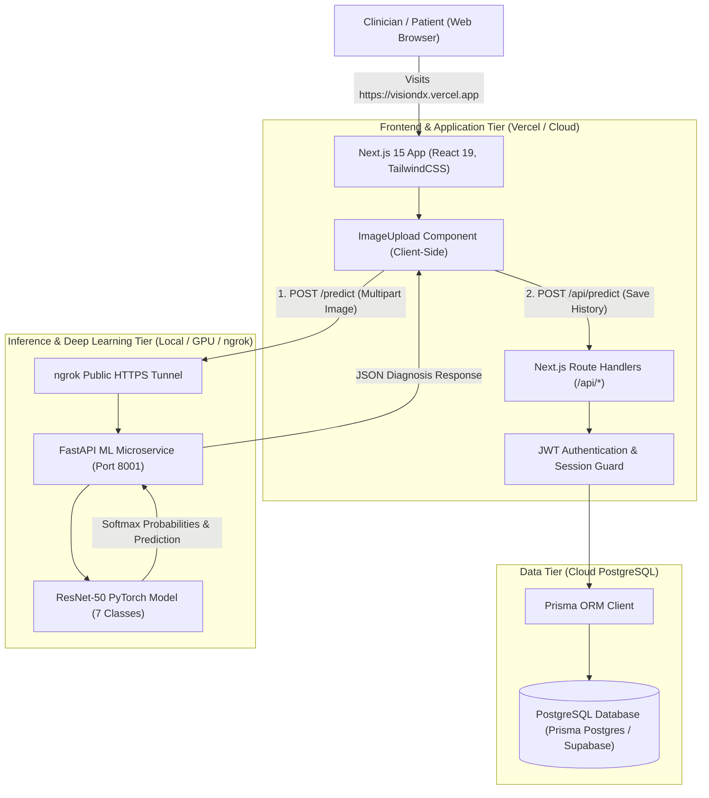
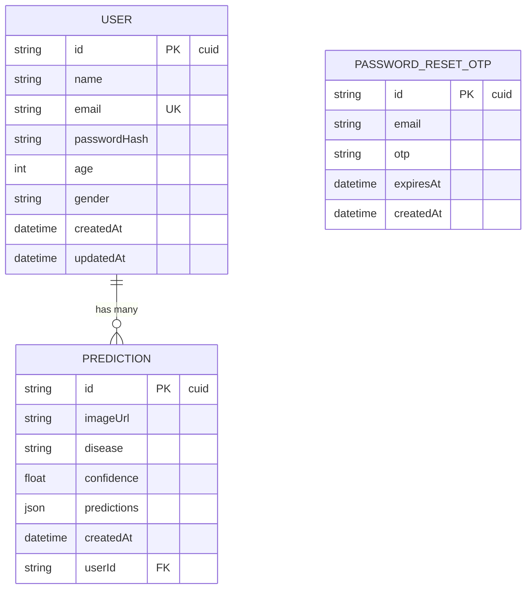
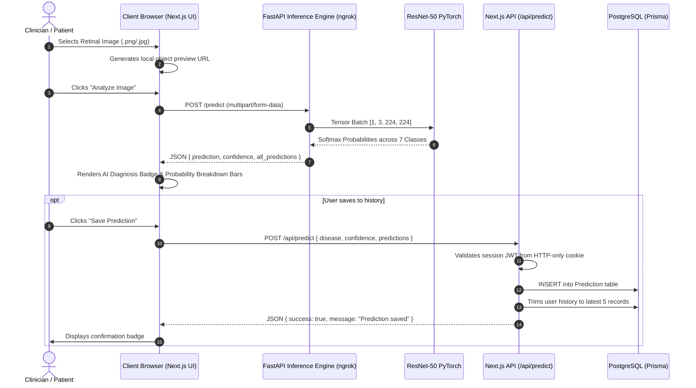

# VisionDX — System Design & Architecture Document

VisionDX is an AI-powered retinal disease screening and diagnostics platform combining deep learning computer vision with a modern web application for automated multi-disease classification and patient diagnostic history management.

---

## 1. System Overview & Architecture

VisionDX utilizes a decoupled, hybrid-cloud architecture separating the high-performance ML inference runtime from the web application and data tier:



---

## 2. Technology Stack

| Layer | Technologies & Frameworks | Description |
| :--- | :--- | :--- |
| **Frontend UI** | Next.js 15, React 19, TypeScript, TailwindCSS | Server-side rendered pages with interactive client components and glassmorphism UI |
| **Data Persistence** | PostgreSQL, Prisma ORM 7.x | User accounts, diagnostic records, and OTP authentication tracking |
| **Auth & Security** | JWT (`jose`), HTTP-only Cookies, Bcryptjs | Stateless session management and password hashing |
| **ML Microservice** | FastAPI, Uvicorn, Python 3.13, Pillow | High-throughput asynchronous REST API for model serving |
| **Machine Learning** | PyTorch 2.x, Torchvision (ResNet-50) | Custom-head convolutional neural network trained on retinal fundus images |
| **Networking & Tunneling**| ngrok (Secure HTTPS Reverse Tunnel) | Bridges cloud-hosted frontend (Vercel) to local inference compute |

---

## 3. Machine Learning Pipeline & Classification

### 3.1 Neural Network Architecture
* **Backbone:** ResNet-50 (Residual Networks with 50 layers, pretrained feature extractor)
* **Custom Classification Head:**
  ```python
  model.fc = nn.Sequential(
      nn.Dropout(0.3),
      nn.Linear(model.fc.in_features, num_classes) # num_classes = 7
  )
  ```

### 3.2 Target Disease Classes
The model evaluates retinal fundus photographs across 7 distinct medical classifications:
1. **AMD** (Age-related Macular Degeneration)
2. **Cataract**
3. **DR** (Diabetic Retinopathy)
4. **Glaucoma**
5. **Hypertensive Retinopathy**
6. **Normal Fundus** (Healthy Retina)
7. **Pathological Myopia**

### 3.3 Preprocessing & Transformation Pipeline
Input images undergo standard computer vision normalization matching the training distribution:
$$\text{Input Image} \longrightarrow \text{Resize}(224, 224) \longrightarrow \text{ToTensor}() \longrightarrow \text{Normalize}(\mu, \sigma)$$
* **Mean ($\mu$):** `[0.485, 0.456, 0.406]`
* **Standard Deviation ($\sigma$):** `[0.229, 0.224, 0.225]`

---

## 4. API Specifications & Contracts

### 4.1 ML Inference Microservice (`FastAPI`)

#### `POST /predict`
Performs real-time deep learning inference on an uploaded retinal fundus image.

* **Headers:**
  * `Content-Type: multipart/form-data`
  * `ngrok-skip-browser-warning: true` *(for ngrok tunnels)*
* **Request Body:**
  * `file`: Binary image file (`image/jpeg`, `image/png`)
* **Response Contract (200 OK):**
  ```json
  {
    "prediction": "Glaucoma",
    "confidence": 98.45,
    "all_predictions": {
      "AMD": 0.12,
      "Cataract": 0.05,
      "DR": 0.35,
      "Glaucoma": 98.45,
      "Hypertensive_Retinopathy": 0.21,
      "Normal_Fundus": 0.42,
      "Pathological_Myopia": 0.40
    }
  }
  ```

#### `GET /health`
* **Response Contract (200 OK):**
  ```json
  {
    "status": "healthy",
    "model_loaded": true,
    "device": "cpu"
  }
  ```

---

### 4.2 Next.js Application Route Handlers

| Route | Method | Access | Purpose |
| :--- | :---: | :---: | :--- |
| `/api/auth/signup` | `POST` | Public | Register user account with hashed password |
| `/api/auth/login` | `POST` | Public | Verify credentials and issue JWT cookie (`visiondx_token`) |
| `/api/auth/logout` | `POST` | Public | Invalidate session cookie |
| `/api/predict` | `POST` | Authenticated | Persist diagnostic record (keeps latest 5 records per user) |
| `/api/profile` | `GET` | Authenticated | Retrieve authenticated user details & past predictions |

---

## 5. Database Schema (Prisma)



---

## 6. End-to-End Diagnostic Sequence



---

## 7. Security & Environment Configuration

### Environment Variables Matrix

| Variable | Scope | Target | Purpose |
| :--- | :--- | :--- | :--- |
| `DATABASE_URL` | Server-only | Vercel / Local `.env` | Connection string for PostgreSQL database |
| `JWT_SECRET` | Server-only | Vercel / Local `.env` | Secret key for signing and verifying user session JWTs |
| `NEXT_PUBLIC_API_URL` | Client & Server | Vercel / Local `.env` | Public HTTPS base URL for ML backend (`ngrok` tunnel or cloud endpoint) |

### Key Security Controls
* **CORS Protection:** Explicit whitelist in FastAPI restricting allowed origins (`https://visiondx.vercel.app`, `localhost:3000`).
* **Session Integrity:** JWT stored in `HttpOnly`, `SameSite=Lax`, `Secure` cookies to mitigate XSS attacks.
* **Input Validation:** Multipart type verification (`image/jpeg`, `image/png`) and dimension normalization prior to feeding tensors into model memory.
