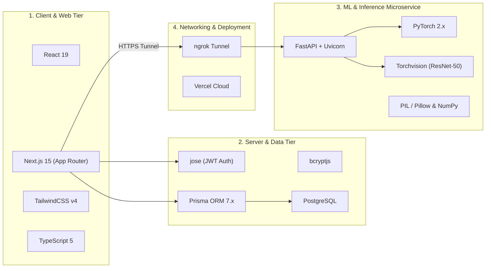

# VisionDX — Technology Stack Guide: What, Where & Why

This document provides a comprehensive technical breakdown of every language, framework, library, tool, and infrastructure component used across the **VisionDX** platform, detailing **what** it is, **where** in the codebase it operates, and **why** it was chosen.

---

## 🗺️ High-Level Architectural Map

---

## 1. Machine Learning & Computer Vision (Inference Tier)

### 🔹 PyTorch & Torchvision
* **What it is:** The leading scientific deep learning framework and computer vision library.
* **Where it is used:**
  * [`visiondx-new/ml-backend/model.py`](file:///c:/Users/Aarush/OneDrive/Desktop/VisionDX-NEW/visiondx-new/ml-backend/model.py) — Defines model architecture.
  * [`visiondx-new/ml-backend/app.py`](file:///c:/Users/Aarush/OneDrive/Desktop/VisionDX-NEW/visiondx-new/ml-backend/app.py) — Loads `visiondx_resnet50_best.pth` weights and executes inference tensors.
  * [`visiondx-new/ml-backend/train.py`](file:///c:/Users/Aarush/OneDrive/Desktop/VisionDX-NEW/visiondx-new/ml-backend/train.py) & [`dataset.py`](file:///c:/Users/Aarush/OneDrive/Desktop/VisionDX-NEW/visiondx-new/ml-backend/dataset.py) — Dataset pipeline, batching, and training loops.
* **Why it was chosen:**
  * **Dynamic Computational Graphs:** Makes inference debugging and tensor manipulation intuitive in Python.
  * **Standardized Pretrained Models:** Torchvision provides pre-trained ResNet weights and established image normalization transforms ($\mu, \sigma$).
  * **Device Agnostic:** Seamlessly runs on CUDA GPU or CPU with `torch.device`.

### 🔹 ResNet-50 (Residual Networks)
* **What it is:** A 50-layer deep convolutional neural network with residual shortcut connections.
* **Where it is used:**
  * [`visiondx-new/ml-backend/models/visiondx_resnet50_best.pth`](file:///c:/Users/Aarush/OneDrive/Desktop/VisionDX-NEW/visiondx-new/ml-backend/models/visiondx_resnet50_best.pth) — Trained model checkpoint.
* **Why it was chosen:**
  * **Mitigates Vanishing Gradients:** Residual skip connections enable deep feature extraction without gradient decay.
  * **Ideal for Medical Imaging:** ResNet-50 is the gold standard benchmark in fundus photography analysis, extracting subtle micro-vascular lesions, hemorrhages, and optic disc cup-to-disc ratios.
  * **Custom Head Adaptation:** Fully-connected layer replaced with `nn.Dropout(0.3)` and `nn.Linear(2048, 7)` to prevent overfitting while outputting 7 disease probabilities.

### 🔹 Pillow (PIL) & NumPy
* **What it is:** Python Imaging Library and high-performance numerical array library.
* **Where it is used:**
  * [`visiondx-new/ml-backend/app.py`](file:///c:/Users/Aarush/OneDrive/Desktop/VisionDX-NEW/visiondx-new/ml-backend/app.py#L182) — Reads incoming multipart bytes from `UploadFile` and converts to standard RGB.
  * [`visiondx-new/ml-backend/dataset.py`](file:///c:/Users/Aarush/OneDrive/Desktop/VisionDX-NEW/visiondx-new/ml-backend/dataset.py) — Loads and augments training images.
* **Why it was chosen:**
  * Efficiently handles corrupted headers, EXIF orientation, and multi-channel image decoding before PyTorch tensor transforms.

---

## 2. ML API Microservice

### 🔹 FastAPI
* **What it is:** A modern, high-performance web framework for building APIs with Python based on standard type hints.
* **Where it is used:**
  * [`visiondx-new/ml-backend/app.py`](file:///c:/Users/Aarush/OneDrive/Desktop/VisionDX-NEW/visiondx-new/ml-backend/app.py#L38) — Hosts `/predict` and `/health` REST endpoints.
* **Why it was chosen:**
  * **Asynchronous Speed:** Built on Starlette and Pydantic, providing sub-millisecond route handling alongside CPU/GPU inference.
  * **Automatic OpenAPI / Swagger Docs:** Generates interactive `/docs` UI for testing predictions without extra tooling.
  * **Native Multipart Streaming:** Handles heavy raw medical image uploads via `python-multipart` with minimal memory footprint.

### 🔹 Uvicorn
* **What it is:** An ultra-fast ASGI (Asynchronous Server Gateway Interface) web server implementation for Python.
* **Where it is used:**
  * Server entry point running on port `8001`.
* **Why it was chosen:**
  * Provides production-grade ASGI event loop concurrency (`uvloop`) and hot-reloading (`--reload`) during local experimentation.

---

## 3. Frontend & Application Framework

### 🔹 Next.js 15 (App Router)
* **What it is:** The enterprise React framework for full-stack production web applications.
* **Where it is used:**
  * Entire `visiondx-new/` web application structure (`app/layout.tsx`, `app/page.tsx`, `app/api/*`).
* **Why it was chosen:**
  * **Hybrid Server & Client Architecture:** Server components render landing content with optimal SEO and zero client JavaScript overhead, while client components (`"use client"`) handle interactive image uploads and predictions.
  * **Integrated API Route Handlers:** Hosts backend auth routes and database endpoints within the same application codebase without needing a separate Node.js server.
  * **Zero-Config Deployment on Vercel:** Seamless CI/CD, automatic Edge network distribution, and serverless scalability.

### 🔹 React 19
* **What it is:** Modern declarative UI library for building interactive component trees.
* **Where it is used:**
  * [`app/components/ImageUpload.tsx`](file:///c:/Users/Aarush/OneDrive/Desktop/VisionDX-NEW/visiondx-new/app/components/ImageUpload.tsx), [`app/components/ProfileClient.tsx`](file:///c:/Users/Aarush/OneDrive/Desktop/VisionDX-NEW/visiondx-new/app/components/ProfileClient.tsx), and auth pages.
* **Why it was chosen:**
  * State primitives (`useState`, `useRef`, `useEffect`) provide reactive real-time feedback (upload previews, confidence progress bars, dynamic error messaging).

### 🔹 TypeScript 5
* **What it is:** Strongly typed superset of JavaScript.
* **Where it is used:**
  * All `.ts` and `.tsx` files across `visiondx-new/`.
* **Why it was chosen:**
  * **Strict API Type Safety:** Matches Prisma generated types and API response structures, preventing runtime `undefined` property errors during inference response parsing.

### 🔹 TailwindCSS v4 & PostCSS
* **What it is:** Utility-first CSS framework for rapid modern UI styling.
* **Where it is used:**
  * [`app/globals.css`](file:///c:/Users/Aarush/OneDrive/Desktop/VisionDX-NEW/visiondx-new/app/globals.css) and inline utility classes across all components.
* **Why it was chosen:**
  * **Zero Runtime Overhead:** Compiles down to minimal static CSS.
  * **Glassmorphism & Gradients:** Enables clean dark/light mode aesthetics, glowing cyan accents, and responsive layout grids.

---

## 4. Authentication, Security & Database

### 🔹 PostgreSQL & Prisma ORM 7.x
* **What it is:** Robust relational SQL database paired with Next-generation TypeScript ORM.
* **Where it is used:**
  * [`visiondx-new/prisma/schema.prisma`](file:///c:/Users/Aarush/OneDrive/Desktop/VisionDX-NEW/visiondx-new/prisma/schema.prisma) — Defines `User`, `Prediction`, and `PasswordResetOTP` tables.
  * [`visiondx-new/lib/prisma.ts`](file:///c:/Users/Aarush/OneDrive/Desktop/VisionDX-NEW/visiondx-new/lib/prisma.ts) — Global singleton client.
  * [`app/api/predict/route.ts`](file:///c:/Users/Aarush/OneDrive/Desktop/VisionDX-NEW/visiondx-new/app/api/predict/route.ts) — Automatically saves predictions and keeps the latest 5 records per user.
* **Why it was chosen:**
  * **Relational Integrity:** Guarantees foreign-key cascade deletes (deleting a user safely cleans up all their diagnostic history).
  * **Auto-generated Type Definitions:** Prisma generates typed models directly into `app/generated/prisma`, eliminating manual interface syncing.

### 🔹 `jose` (JWT) & `bcryptjs`
* **What it is:** High-performance cryptographic JSON Web Token library and password-hashing utility.
* **Where it is used:**
  * [`visiondx-new/lib/auth.ts`](file:///c:/Users/Aarush/OneDrive/Desktop/VisionDX-NEW/visiondx-new/lib/auth.ts) & `app/api/auth/*` route handlers.
* **Why it was chosen:**
  * **Edge Runtime Compatibility:** `jose` runs natively in both Node.js and Vercel Edge runtimes without native C bindings.
  * **Stateless Security:** Session authentication managed via secure, `HttpOnly`, `SameSite=Lax` cookies (`visiondx_token`), protecting user tokens against XSS extraction.

---

## 5. Networking, Tunneling & Cloud Infrastructure

### 🔹 ngrok (Secure HTTPS Reverse Tunnel)
* **What it is:** Ingress reverse proxy providing public HTTPS endpoints for local servers.
* **Where it is used:**
  * Connects `https://visiondx.vercel.app` (cloud) to `http://127.0.0.1:8001` (local ML backend).
* **Why it was chosen:**
  * **Eliminates Mixed-Content Browser Blocking:** Browsers block requests from HTTPS sites to local HTTP URLs (`http://127.0.0.1`). ngrok provides valid TLS certificates.
  * **Instant Live Demo Workflow:** Enables live real-time model inference from any external laptop or phone without needing expensive cloud GPU hosting during testing and demonstrations.

### 🔹 Vercel Platform
* **What it is:** Global cloud platform for serverless frontend applications.
* **Where it is used:**
  * Production hosting for `https://visiondx.vercel.app`.
* **Why it was chosen:**
  * Automated Git-triggered CI/CD builds, environment variable management, and global CDN caching.

---

## 📊 Summary Comparison Matrix

| Technology | Layer | Primary File / Location | Key Reason Selected |
| :--- | :--- | :--- | :--- |
| **PyTorch / Torchvision** | AI Engine | `ml-backend/app.py` | Industry standard for tensor ops & pretrained ResNet |
| **ResNet-50** | Deep Learning | `ml-backend/models/*.pth` | Superior feature extraction for 7 retinal conditions |
| **FastAPI** | Inference API | `ml-backend/app.py` | Asynchronous speed, automatic `/docs`, typed schemas |
| **Next.js 15** | Web Full-Stack | `visiondx-new/app/` | Server/Client hybrid rendering + Serverless API routes |
| **Prisma + PostgreSQL**| Database | `prisma/schema.prisma` | Strongly typed relational storage + auto history pruning |
| **TailwindCSS v4** | UI Design | `app/globals.css` | Modern glassmorphism, responsive grid, zero CSS bloat |
| **jose + bcryptjs** | Security | `lib/auth.ts` | Edge-compatible JWT verification & password hashing |
| **ngrok** | Networking | CLI Tunnel (`port 8001`) | Public HTTPS bridge connecting cloud frontend to local AI |
